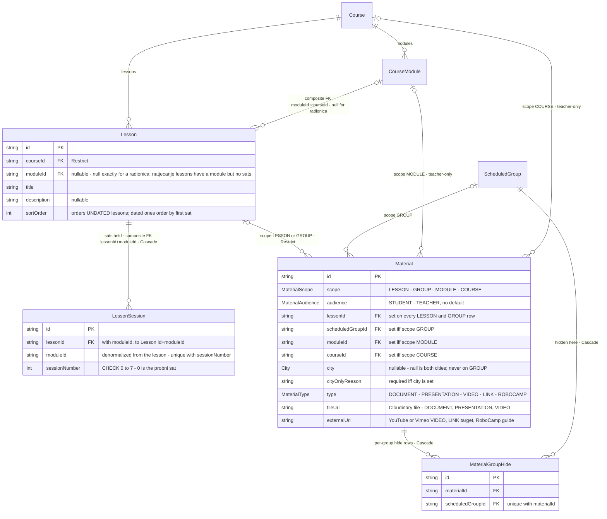
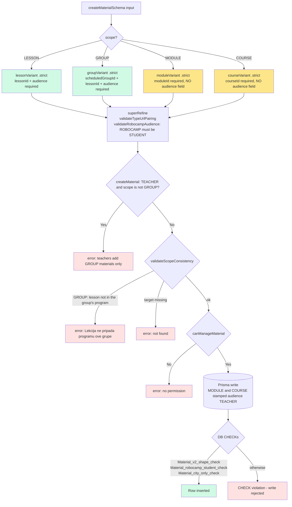
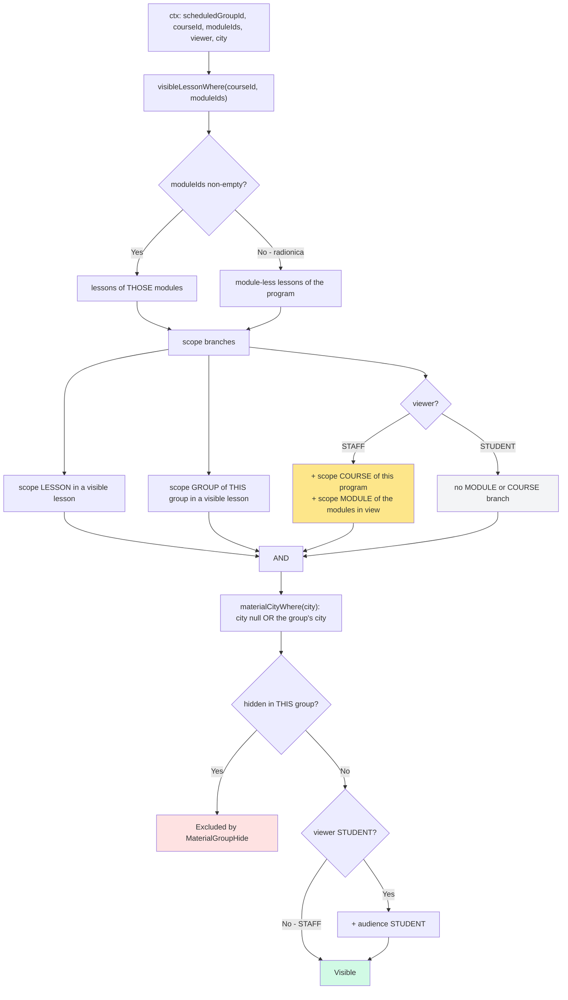
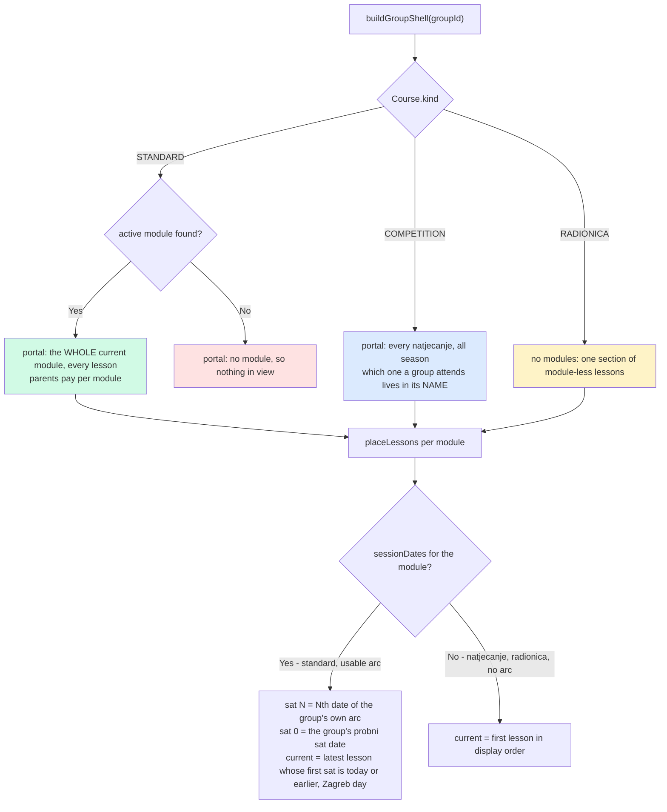
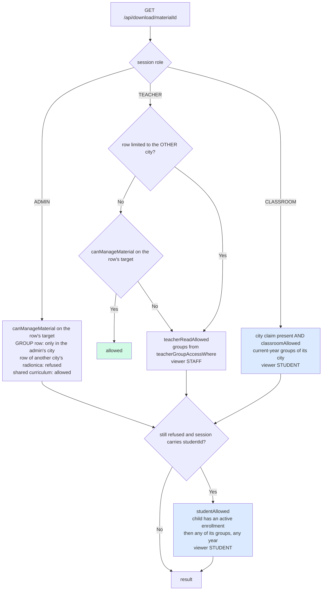
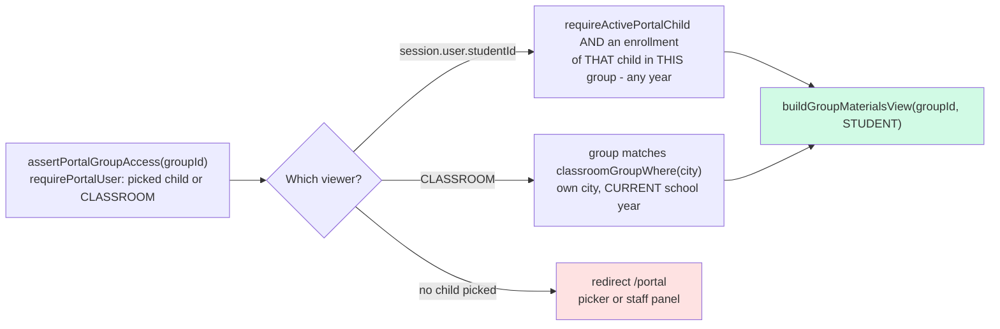

# Materials — Lessons, Audience, Scope, City and Per-Group Hide

Materijali v2 (2026-10-10). The curriculum is **program → module → lesson → material**. Every `Material` row carries two independent answers:

- **`scope`** — where it sits: `LESSON` (curriculum lesson material, shared by every group of the program), `GROUP` (one group's own addition — it sits in a lesson too), or the two teacher-only exceptions `MODULE` ("every class of this module") and `COURSE` ("every class of this program").
- **`audience`** — who it is for: `STUDENT` (the portal — a parent account with a chosen child, the classroom account — and staff) or `TEACHER` (staff only). There is deliberately **no `@default`**: a forgotten audience must be a tsc error, never a silent publication to parents.

**Everything a child can see sits in a lesson.** `MODULE` and `COURSE` survive only as teacher-only rows, the one owner-approved exception. RoboCamp guides are always `STUDENT`. All of it is enforced at the DB (`Material_v2_shape_check`, `Material_robocamp_student_check`), again in Zod, and again in the actions.

**Lessons bind to sat NUMBERS, never dates.** A `LessonSession` row says "this lesson holds sat N of this module" (1–7; **0 = probni sat**, only on a standard program's first module). A module's dates differ per weekday group (race-ahead arc), per city, per year, and move with every holiday change, while a lesson is the same everywhere and is reused every year. Where a lesson lands is computed per group at read time (`placeLessons`, below). Lessons are **admin-only, shared by both cities, not year-scoped** (`src/actions/admin/lessons.ts`, placement rules in `src/lib/lesson-rules.ts`); a radionica's lessons belong to its city, since the radionica itself does.

**One curriculum for both cities; city-only is a deliberate exception.** `Material.city` null = both cities (the norm, and the only outcome of adding a material — there is no location field on the form). An admin may limit a curriculum row (`LESSON`/`MODULE`/`COURSE` of a **shared** program) to their own city only through "Samo za <grad>…" with a required reason (`setMaterialCityOnly`, `src/actions/admin/material-city.ts`). The other city's admin still sees the row on the program and lesson pages — greyed, "Samo <grad>" + the reason, read-only — so drift is visible; only the owning city edits, moves, deletes or returns it ("Vrati u oba grada", `otherCityOnlyError` in `src/lib/material-city.ts`). `GROUP` rows never carry a city (they belong to their group's city already), and a radionica's rows don't need one (the program belongs to one city as a whole).

## Schema shape

> Source: `prisma/schema.prisma` (`Lesson`, `LessonSession`, `Material`, `MaterialGroupHide`, `MaterialScope`, `MaterialAudience`). The composite FKs are what make "one lesson per sat" and "a lesson stays in its own program" DB facts: `Lesson (moduleId, courseId) → CourseModule (id, courseId)` and `LessonSession (lessonId, moduleId) → Lesson (id, moduleId)` with `@@unique([moduleId, sessionNumber])`. `Material.lessonId` is `Restrict`, so a lesson that still holds any material cannot be deleted. Migrations: `20261010120000_materials_v2_enums` (enum values in their own migration — Postgres refuses to use a value added by `ALTER TYPE … ADD VALUE` in the same transaction), `20261010120100_materials_v2_lessons` (tables, data placement, checks), `20261010180000_material_city_only`.

## Shape — what a row may look like

The four legal shapes (`Material_v2_shape_check`):

| Scope | `lessonId` | `scheduledGroupId` | `moduleId` | `courseId` | `audience` |
|---|---|---|---|---|---|
| `LESSON` | set | null | null | null | either |
| `GROUP` | set | set | null | null | either |
| `MODULE` | null | null | set | null | `TEACHER` only |
| `COURSE` | null | null | null | set | `TEACHER` only |

Plus `Material_robocamp_student_check` (`type <> 'ROBOCAMP' OR audience = 'STUDENT'`) and `Material_city_only_check` (`city` and `cityOnlyReason` both null, or both set on a `LESSON`/`MODULE`/`COURSE` row). The one rule the DB **cannot** check across tables — a `GROUP` row's lesson belongs to that group's program — lives in `validateScopeConsistency` (`src/actions/material/crud.ts`). Where a *lesson* may sit is `lessonPlacementError` (`src/lib/lesson-rules.ts`): a radionica lesson has no module and no sats, a natjecanje lesson has a module but no sats, a standard lesson may hold sats 1–7, and sat 0 only on the program's first module.

> Sources: Zod variants in `src/lib/validators/material.ts`; actions in `src/actions/material/crud.ts` (`createMaterial`, `validateScopeConsistency`) and `src/actions/material/move.ts` (`setMaterialsAudience` — "Premjesti u polaznike / nastavnike", all-or-nothing; `moveMaterialToLesson`); checks in `prisma/migrations/20261010120100_materials_v2_lessons/migration.sql` and `prisma/migrations/20261010180000_material_city_only/migration.sql`. Belt-and-braces by design — Zod gives the Croatian message next to the field; the CHECKs stop raw SQL or a forgotten migration. Scope, lesson and audience are not editable through `updateMaterial`; moving is its own action. Moving TO polaznici always asks (`<ConfirmDialog>`); moving to nastavnici does not.

## The one visibility rule — `buildEffectiveMaterialsWhere`

Every read of "what applies to this group" goes through `buildEffectiveMaterialsWhere({ scheduledGroupId, courseId, moduleIds, viewer, city })` (`src/lib/material-query.ts`). The **viewer** is the line between the staff room and the portal:

- **`STUDENT`** — every portal read (`getEffectiveMaterialsForStudent` → `buildGroupMaterialsView(groupId, 'STUDENT')`) and the child and classroom branches of `/api/download/[materialId]`. Only `STUDENT`-audience rows, only inside lessons. Never query materials for a portal payload any other way.
- **`STAFF`** — both audiences plus the teacher-only `MODULE`/`COURSE` rows. Used by the substitute's download path (`teacherReadAllowed`).
- **`visibleLessonWhere` never returns both kinds of lesson.** With modules in view it admits only those modules' lessons; only when there are none (a radionica) does it admit module-less lessons. A module-less lesson on a program *with* modules is not something the editor creates, and if raw data ever produced one it must not become downloadable while no page lists it.
- **City.** A row limited to the other city does not exist for this group, for every viewer — portal, staff group view and downloads.

> The presenter (`getGroupGuidesForStaff`, `src/actions/teacher/materials.ts`) deliberately builds the **STUDENT** view: what goes on the classroom wall is what the children themselves can open, hides included. The staff Materijali tab (`getStaffGroupLessons`) is built from its own staff query instead, because it must also list rows hidden in this group (dimmed, re-showable) — it applies the same scope union and the same `materialCityWhere(group.city)`, over every module of the program.

## Which modules are in view — and which lesson is current

`buildGroupShell` (`src/lib/group-materials-view.ts`, `cache()`-wrapped — the portal group layout and the Materijali panel both resolve it on every navigation) turns `Course.kind` into the portal's `visibleModuleIds` and computes each standard module's seven sat dates on **this group's** arc (`moduleSessionDates`, from `getGroupModuleArc`). `buildGroupMaterialsView(groupId, viewer)` then picks the modules: **staff see every module**; the portal sees `visibleModuleIds`.

- **`placeLessons`** (`src/lib/lesson-schedule.ts`, pure and client-safe) orders a module's lessons by first sat (probni sat first), undated after by `sortOrder`, and picks the current one. In dated mode a lesson is current from its first sat's Europe/Zagreb day until the next lesson's first sat; before any lesson has started nothing is current and the UI decides what to open. The probni sat date comes from `resolveTrialDateForGroup`, keyed on the group's **own** `schoolYear`, and only when the first module is in view and holds a sat-0 lesson.
- **The portal shows the whole current module with the current lesson open** (`<LessonAccordion>`). A child is shown WHAT KIND a material is (`displayKindOf`, `src/lib/material-display.ts`), never WHERE IT CAME FROM — curriculum and the group's own additions look the same.
- **`interactiveGuides(view)`** lifts every RoboCamp guide out of every lesson in view and tags it with its module and lesson; `inCurrentLesson` is true only for a **dated** current lesson, so undated natjecanje or radionica lessons never all claim to be today's.

## Per-group hide

`MaterialGroupHide (materialId, scheduledGroupId)` lets regular staff of one group hide an inherited program material from that group only (`setMaterialHidden`, `src/actions/material/crud.ts`). The caller must pass `canManageMaterial(session, { scope: 'GROUP', scheduledGroupId })` — a `TeacherAssignment` on the group, or an admin of its city. **Only `LESSON`, `MODULE` and `COURSE` rows can be hidden**; a `GROUP` row already belongs to the group, so it is edited or deleted instead. A hidden row drops out of `buildEffectiveMaterialsWhere` for every viewer of that group — portal, presenter and downloads — while the staff Materijali tab keeps listing it dimmed with a toggle.

## Downloads — `/api/download/[materialId]`

`src/app/api/download/[materialId]/route.ts` authorises off the session and answers a miss with 404, indistinguishable from a missing file.

- **All three group-based branches share `materialVisibleInGroups(groups, materialId, viewer)`**: the same `buildEffectiveMaterialsWhere` union, city filter and `MaterialGroupHide` exclusion — only the group set and the viewer differ. For visibility it passes **every module of the group's program**, not just the current one: the route answers "may this viewer have this file", not "is it on the page right now".
- **TEACHER.** `canManageMaterial` answers per *program*, not per city — a Šibenik teacher on SLR 1 would pass it for a Split-only SLR 1 file — so it is skipped for a row limited to the other city, and the city-aware `teacherReadAllowed` decides. That second path is also what lets a **substitute** (a `SessionStaffChange`, no `TeacherAssignment`) read and download every material effectively visible in a group `teacherGroupAccessWhere` (`src/lib/teacher-guard.ts`) opens: preparing with the materials is the point of the access window, which ends with the termin's day. **Managing** materials (`canManageMaterial`, `src/lib/material-access.ts` — create, edit, hide, move, delete) still requires a real `TeacherAssignment`; a substitute gets none of it.
- **ADMIN.** `canManageMaterial` admits any `LESSON`/`MODULE`/`COURSE` target of a shared program (`programCityOf` = null) or of the admin's own city, and `GROUP` targets only in the admin's city. The download branch is that same call on the row's `materialTarget` — the answer the program and lesson pages give — so a `GROUP` row of another city and a row of another city's radionica both read as missing. A city-only row of a **shared** program stays readable to the other city's admin — it is listed for them, greyed — but only the owning city may change it.
- **CLASSROOM** (the shared classroom login, 2026-09-20) resolves to `!!session.user.city && classroomAllowed(city, materialId)`. The `!!city` half **fails closed**, because Prisma reads `city: undefined` as "no filter" and a legacy token would otherwise open both cities. The account holds no enrollments, so its groups are every `ScheduledGroup` matching `classroomGroupWhere(city)` (`src/lib/classroom-access.ts` — own city, **current school year**). The elearning proxy admits `CLASSROOM` too (`ALLOWED_ROLES` = `TEACHER | ADMIN | CLASSROOM`), since the RoboCamp guide iframe is same-origin and rides the session cookie; a family session gets in only while it carries a `studentId`.
- **Child.** Since 2026-08-17 the child branch is gated on being currently in a program, and since 2026-09-29 it runs for any session carrying a picked child (`session.user.studentId` — a parent, or staff whose e-mail is the parent's), **after** the staff branches and never instead of them, so the picked child can only ever add what that child may already open. `studentAllowed(studentId, …)` counts that child's enrollments against `activeEnrollmentWhere()` (`src/lib/enrollment-activity.ts` — current year **plus next**) and returns false at zero, before any visibility check; `getEffectiveMaterialsForStudent` goes through `assertPortalGroupAccess` → `requireActivePortalChild()` for the same reason. Without it, "no longer part of any program" would hold at the login form and not here, for as long as a `studentId` claim written while the child was still enrolled survives (≤60 s). The child's group list stays deliberately **unfiltered by year** — an enrolled child re-opening their own previous group is legitimate. The asymmetry with the classroom account (current year only) is deliberate.

## Portal entry — who reaches a group

> `assertPortalGroupAccess` (`src/lib/portal-group-access.ts`) is the only gate that admits both a family session looking at a child and the shared classroom login. The child is the session's `studentId` claim (picked on `/portal/odabir`, or set at login when the parent has one child) — never `session.user.id`, which is the parent account. Everything downstream is identical for the two; what differs is how the group was reached. A miss on either branch is `notFound()`. Gallery, evaluation and profile keep `requirePortalChild()` and are therefore closed to CLASSROOM.

## Summary

| Scope | Sits in | Audience | Who adds it | What the portal sees | City posture | Hide per group? |
|---|---|---|---|---|---|---|
| `LESSON` | a `Lesson` of the program | `STUDENT` or `TEACHER` | admin (lesson editor) | `STUDENT` rows of the lessons in view — standard: the current module, natjecanje: all, radionica: the module-less lessons | shared; may be limited to one city with a reason | Yes |
| `GROUP` | a `Lesson` of the group's program + one `ScheduledGroup` | `STUDENT` or `TEACHER` | the group's teacher or an admin of its city | `STUDENT` rows, in that group only, inside their lesson | per-city through its group; never city-only | No — edit or delete it |
| `MODULE` | no lesson — the whole module | `TEACHER` only | admin | never | shared; may be city-only | Yes |
| `COURSE` | no lesson — the whole program | `TEACHER` only | admin | never | shared; may be city-only | Yes |

## Data migration (2026-10-10)

`20261010120100_materials_v2_lessons` placed every existing material and deleted nothing: `MODULE` materials went into one lesson per module — on sat 1 for a standard program, undated for a natjecanje — named after the project on a standard program's first module ("1. Puž", "1. Vrtuljak", "1. Sova", "1. Spirograf", "1. Polagač mosta (mostonoša)") and "1. lekcija" elsewhere; program-wide "Probni sat" materials and RoboCamp guides of a standard program into a "Probni sat" lesson on sat 0, radionica `COURSE` and `GROUP` materials into a module-less "1. lekcija", `GROUP` rows of a program with modules into its first-module lesson, and the remaining program-wide documents stayed `COURSE` as teacher-only rows. **RoboCamp → `STUDENT`, everything else → `TEACHER`**; the owner moves the rest to the children by hand. The temporary `DEFAULT 'TEACHER'` used to fill the column is dropped at the end of the migration.
